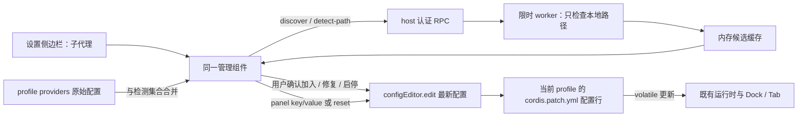

# 子代理设置分区：界面与开发方案

日期：2026-11-08。基线：插件 1.1.25，目标宿主 dsh 桌面版 0.2.2-rc.1。本文为待实施方案，本次只交付文档与 HTML / PNG 示意图，不修改插件代码、配置、版本号或构建产物，不提交、不发布。

## 1. 设计决定与验收目标

完整管理界面统一放在 **设置 → 子代理**。后端列表由本机检测结果和用户已有配置产生，不再把七个已知后端当成固定目录显示。保留一个设置分区，搜索、添加、编辑均在原位展开。

| 项目 | 决定 | 验收标准 |
| --- | --- | --- |
| 设置入口 | `settings.section`；id 复用 `qoder-subagent`，中文 label thunk `() => "子代理"`，建议 `order: 17` | 账户 -10 → 插件 15 → 子代理 17 → 智能体预设 20；插件只注册一处分区 |
| 唯一管理位置 | 删除完整 `plugins.bundle.config` 注册，推荐不留插件自定义配置区 | 插件详情无第二份管理表单 |
| Tab | 只保留运行视图；去掉「管理」按钮，换成纯文字「管理后端：设置 → 子代理」 | 无不可用的设置跳转按钮，不调用 shell 内部 openSection |
| 后端列表 | `configured ∪ detected`，详见第 4 节 | 空安装不出现七个未安装条目；旧配置不丢失、不隐藏 |
| 两个添加入口 | 「搜索本机 CLI」「手动添加」，同一区块内互斥展开 | 搜索结果须逐条点击「加入」才写配置 |
| 即时生效 | 面板继续使用现有 `panel` RPC 与 volatile 叶子字段 | 点击立即反馈，配置成功写回当前 profile，Dock / Tab 随即更新 |
| 轻量实现 | React 现有组件与样式令牌；Node 内置 fs / path / worker_threads | 不新增第三方运行依赖、不联网搜索、不改 dsh 核心 |

入口顺序使用宿主已知 order 值推导；其他插件也可能占用 17，因此真实宿主验收还要检查是否出现同序冲突。不要改宿主其他分区的排序。

### 已核实的实现边界

- [src/panel.js](src/panel.js) 的 `Settings` 已是现行完整管理面板；实际 `plugins.bundle.config` 注册在 `registerPanel()` 中，不在 `client.js`。
- [src/client.js](src/client.js) 的旧 `QoderSection({ form, connection })` 未注册，而且依赖 config form。设置分区 owner props 只有 `{ close }`，不能把旧组件直接重新挂上去。
- [lib/index.js](lib/index.js) 的 `backends` 路由目前遍历 `BUILTIN_PROVIDERS` 与配置的并集，导致未安装后端也返回；`Backends` 再把它们放进「其他后端」。两层都要改。
- `resolveBinary()` 返回显式路径时不检查存在；命令名查不到也可能原样返回。返回值非空不等于可用；Windows 现有 `existsSync` 也不能排除目录。
- `probeBackend()` 会执行版本、模型命令，并通过 `latestVersionFor()` 查更新；**本机搜索不能调用它**。搜索只检测路径和启动形式，不代表已登录、协议正确或模型可用。
- 实际 driver 是六种 `*-json` 值；后端名有七种，`qodercn` 与 `qoder` 复用协议。任务描述中的短名可作界面名称，不能直接写入配置。
- `Settings` 当前请求 `runs { limit: 40 }`，按返回的 runs 计算统计。它没有会话 id 或 native hooks；统计不能标作「本会话」或「全部历史」。
- `panel` 实有九字段，其中六个布尔字段；当前只呈现五个布尔开关。`hideWhenIdle` 虽在 schema/defaults 中，当前没有控件，也没有实际消费逻辑。
- [STATUS.md](STATUS.md) 与 [CHANGES.md](CHANGES.md) 有多次入口迁移记录；以本次源码核查和用户给定的宿主槽位契约为准，不沿用旧文档里互相矛盾的插件页自动表单判断。

## 2. 线框图与视觉层级

临时交付位置：`%TEMP%\codex-mock2\settings-subagent.html` 和同目录 `settings-subagent.png`。PNG 为 1280 × 800，示意数据均为虚构。HTML 不连接宿主，保留少量原型交互，不能用于验证真实 RPC。

```text
┌ 设置 ─────────────┬ 子代理                         [宿主关闭 ×] ┐
│ 账户              │ 管理本机 CLI 与运行面板                     │
│ 插件              │ 跨会话 · 最近 40 条外部运行                 │
│ ● 子代理          │ [总计 12 · 运行 1 · 完成 10 · 出错 1]       │
│ 智能体预设        │                                             │
│                   │ 后端  [搜索本机 CLI] [手动添加]             │
│                   │ ▸ codex    codex-json   可用          [开]  │
│                   │ ▸ pi       pi-json      已停用        [关]  │
│                   │ ▸ review   codex-json   路径失效      [修复] │
│                   │   已启用但不可用；设置保留                  │
│                   │ ┌ 本机搜索 · 找到 3 项 ───────── [收起] ┐   │
│                   │ │ Claude  绝对路径 / 建议协议    [加入] │   │
│                   │ │ Codex   绝对路径 / 建议协议  [已加入] │   │
│                   │ └ 搜索范围：PATH / 常见目录 / npm ─────┘   │
│                   │                                             │
│                   │ 运行面板                                    │
│                   │ 入口与行为              显示与数据          │
│                   │ dock              [开]  范围 [本会话|全部] │
│                   │ 子代理标签页      [开]  卡片 [10|20|40|…]  │
│                   │ 空闲时隐藏        [关]  完成卡片 [30秒 ▾]  │
│                   │ 显示停止按钮      [开]  显示成本      [关] │
│                   │                        并入内置子代理 [关] │
│                   │ 自动保存状态            [恢复面板默认]      │
└───────────────────┴─────────────────────────────────────────────┘
```

### 尺寸与组件规范

- 使用宿主设置外壳与左导航；插件不重画外壳、不增加第二个关闭按钮。示意图中的导航宽约 220px，仅表示入口位置，不要求修改宿主尺寸。
- 内容区左右留白 28–32px，适宜最大宽 960px；标题 20px，正文 13px，辅助说明 12px；行高 1.5。使用现有 `--dsw-alias-*` 颜色令牌，浅深色均须可辨识。
- 统计是一条低对比背景条，不做四张大卡片。后端每行 48–56px；展示名称、协议、可用状态、开关。路径在展开编辑或搜索候选中展示，避免主列表横向撑开。
- 两组面板设置并排，内容宽不足 720px 时变单列；搜索候选区最高 240px，超出内部滚动，整个分区允许纵向滚动。正文不靠缩小字号塞满。
- 同时只开一个搜索 / 手动添加区；后端高级参数独立按行展开。切换添加方式若有未保存输入，先保留草稿，不清空用户输入；关闭设置不写入草稿。
- 所有展开标题用 button，提供 `aria-expanded`；开关有可读名称和 `role="switch"`；搜索状态使用 `aria-live="polite"`。结果返回不抢焦点；加入成功后焦点留在原结果行。

## 3. 交互说明

### 3.1 设置统计与运行视图

设置页统计固定标注 **「跨会话 · 最近 40 条外部运行」**。首次加载显示 `—` 和加载状态；失败显示「运行统计暂不可用」并可重试，不把请求失败显示成零。以 `statsOf(snap.runs)` 的同一集合计算总计 / 运行 / 完成 / 出错，已取消包含在总计内；需要时在总计提示里显示取消数。

`panel.scope` 只控制 Dock / Tab，与设置统计口径无关。`includeNative` 也只影响有会话 hooks 的运行视图；设置页不擅自获取宿主内部全局会话状态。设置页沿用 4 秒轮询，卸载或页面不可见时暂停，重回页面立即刷新；后端发现不加入这个轮询。

成本开关打开时统计多显示金额，注明「CLI 上报；缺报不计入」。关闭时所有受此设置控制的运行详情也不显示金额。保留原始运行数据。

### 3.2 后端行

- 已配置、可用：右侧开关写 `enabled`；关闭显示「已停用；设置保留」。开关是配置意图，不能由探测结果反向修改。
- 已检测、未配置：显示「已检测到 · 未加入」和「加入」，不显示假装已经存在的启用开关。点击后进入同一个添加确认区，预填注册名、绝对路径、建议 driver，用户确认后才写配置。
- 已配置、路径失效：保留普通列表行，以警示标识「路径失效；设置保留」。若原来 `enabled:true`，明确写「已启用但不可用」，允许关闭开关；若为 false，不允许直接开启，先修复。原 true 不自动改 false。
- 未能核实：显示「状态待确认」和重试，不等同于「未安装」。保留最后一次可用状态的时间说明。
- 点击名称展开参数；**停用、缺失和未知 driver 的条目也能编辑**，不沿用目前必须 enabled 才展开的限制。

高级参数包含：二进制路径、协议下拉、默认模型、有序模型回退链、默认强度、并发上限、保存 / 取消。原 `model` / `models` 的优先级不变：非空 `models` 优先。探测出的模型目录放在独立的临时 `catalog` 中，不能点「探测模型」就覆盖用户保存的回退链。强度选项由 driver 限定；不支持时说明「此协议不提供强度覆盖」，旧值仍原样保留，用户明确修改时再写。

二进制输入框使用原始 `configuredBinary`，未配置时为空，以占位说明显示自动解析的路径。不能把解析后的 `binary` 自动填入并随模型修改一起保存，否则会把自动探测无意变成路径锁定。已有字段未被编辑就不发 patch；`permissionMode`、`extraArgs`、上下文窗口、各超时等字段继续原样保留。

列表以已配置条目的原数组顺序展示，再附加未配置的检测项；不按名称重排持久化数组，因为 priority 调度依赖原顺序。本轮不增加删除后端、批量启用或拖动排序，防止混淆「发现 / 加入 / 停用」。

### 3.3 搜索本机 CLI

1. 点击「搜索本机 CLI」展开内联结果区；按钮变为「搜索中…」，同次请求不能重复触发。其他设置仍可操作。
2. host 执行受限本地扫描，正常在 6 秒预算内返回；客户端 RPC 超时 10 秒。无需新增后台任务页面或轮询任务系统。
3. 结果每行展示名字、可选择复制的完整绝对路径、建议协议、来源、是否已在用；视觉上路径可折行，不只放在 tooltip。`inUse` 的含义是「已被 providers 引用」，不是「有任务在运行」。已在用时显示具体注册名。
4. 未引用的结果有「加入」。点后在结果行下方展开紧凑确认区：注册名、路径（只读）、协议下拉、[加入并启用]、[取消]。有建议则预选但保持可见；未知建议必须手选。
5. 成功只写一条 provider，显示「已加入」并刷新主列表；失败保留表单和结果，在本行提示原因。重复点击由 UI pending 与 host 事务校验共同处理。
6. 与失效配置同名但路径不同的候选显示「可修复 review」；点后进入该后端参数区对比新旧路径，按「保存修复」确认。**不能以同名“加入”静默覆盖配置**。同名但不是修复时提示改用别名。
7. 「收起」只收起结果，不取消已开始的配置写入；扫描仍进行时用「取消搜索」，中止该请求。设置页卸载同时取消自己的扫描等待。

| 返回情况 | 界面表现 | 保留与恢复 |
| --- | --- | --- |
| complete 且有候选 | 找到 N 项，逐条加入 | 候选在本次设置会话保留 |
| complete 且无候选 | 未在扫描范围内找到 CLI；可手动添加 | 显示扫描范围，不提示用户安装某个固定后端 |
| partial / 6 秒到期 | 搜索未完成，已找到 N 项；部分位置超时 | 已验证结果可加入；可重试；未检查项不判缺失 |
| 无结果且超时 | 搜索超时，未能完成检测 | 保留旧缓存并标为旧状态；提供重试 / 手动添加 |
| 权限错误 / 截断 | 找到 N 项；部分目录无法读取 / 已达搜索上限 | 结果可用；详情只列相关位置，不打印环境或密钥 |
| RPC 断开 / worker 异常 | 无法搜索本机 CLI | 不清空主列表、配置或上一次结果；显示重试 |

### 3.4 手动添加与 driver

点击「手动添加」原位展开三项：注册名、CLI 绝对路径（旁边「检测路径」）、协议 driver 下拉。首项为「请选择协议驱动」，未知 CLI 不默认 qoder。下面固定说明：

> driver 决定启动参数和 JSON 输出协议，不是随意填写的名称。任意 CLI 只有兼容所选协议，才能作为子代理使用；检测到文件不代表协议兼容或已登录。

| 下拉展示 | 配置 value | 说明 |
| --- | --- | --- |
| Qoder / Qoder CN（qoder-json） | `qoder-json` | 两个发行版共用协议；`qodercn` 是注册名，不是独立 driver |
| OpenCode（opencode-json） | `opencode-json` | 对应现有 OpenCode 参数和事件解析 |
| Pi（pi-json） | `pi-json` | 对应 Pi JSON 模式 |
| CodeBuddy（codebuddy-json） | `codebuddy-json` | 对应 CodeBuddy stream-json |
| Codex（codex-json） | `codex-json` | 对应 Codex exec JSON |
| Claude（claude-json） | `claude-json` | 对应 Claude stream-json |

选项来自 host 的 `Object.keys(DRIVERS)`，客户端只负责友好名称，不自行增加协议。不得写入 `codex`、`pi`、`qodercn` 等短名，也不为它们引入自动重写旧配置的迁移。

「检测路径」只核实普通文件、绝对路径、当前平台可启动形式；结果为「文件存在，协议兼容性将在运行时验证」。选择 driver 或修改路径后旧检测结果失效。三项合法且检测通过后启用「加入并启用」；新增在 host 再次复核路径。不会执行输入中的 CLI、登录、更新或安装。

名称沿用 1–32 位字母 / 数字 / 下划线 / 短横线规则；host 同时拒绝插件保留工具名（至少 `sub_agent_status`、`list_agents`）与已有注册名冲突。宿主已有工具冲突需从实际 tools 能力核实，并捕获注册失败，不能猜一个未公开的查询 API。

第一版只接受本机绝对文件路径，不接收「命令 + 参数」、环境变量插值、URL 或目录；中文和空格路径直接传字符串。Windows `.exe/.com/.cmd/.bat` 及现有 Pi / CodeBuddy 受支持的 Node 入口可检测；POSIX 普通入口需有执行权限，Node 入口按当前启动器规则核实。任意 driver 的任意 `.js` 都可启动这一承诺不成立；不支持的入口提示提供对应可执行文件或受支持的 shim。

### 3.5 六个开关与三个值控件

| 分组 | 中文标签 | key / 默认值 | 行为 |
| --- | --- | --- | --- |
| 入口与行为 | 输入框上方运行条 | `dock: true` | 控制 Dock；说明「有记录时显示摘要」 |
| 入口与行为 | 子代理标签页 | `tab: true` | 控制运行 Tab 及 Dock 的 ↗；设置入口不受影响 |
| 入口与行为 | 空闲时隐藏运行条 | `hideWhenIdle: false` | 无运行中或近期完成卡片时是否隐藏有记录的摘要 |
| 入口与行为 | 显示停止按钮 | `allowStop: true` | 只对可停止的外部任务显示；内置任务仍只读 |
| 显示与数据 | 显示成本 | `showCost: false` | 金额来自 CLI 上报 |
| 显示与数据 | 并入 dsh 内置子代理 | `includeNative: false` | 仅 Dock / Tab；只读、按需挂 NativeProbe |
| 显示与数据 | 运行视图范围 | `scope: "session"` | 本会话 / 全部；不改变设置页统计口径 |
| 显示与数据 | 卡片上限 | `maxCards: 20` | 10 / 20 / 40；已有其他合法值原值显示，不自动改写（schema 1–60） |
| 显示与数据 | 完成卡片停留 | `autoHideSeconds: 30` | 不显示完成卡片（0）/ 10 秒 / 30 秒 / 60 秒 / 5 分钟；旧的其他值原值显示 |

`autoHideSeconds=0` 不是「不自动收起」，实际语义是 Dock 不展示完成卡片，Tab 仍保留记录；需修正当前相反的选项文案。

补齐 `hideWhenIdle` 的最小 Dock 条件：先保留原 `dock`、scope、hideAt 过滤；`visible.length === 0` 始终不出现空的新会话条；已有记录且 `shown.length === 0` 时，仅在 `hideWhenIdle === true` 隐藏，否则显示一行空闲摘要，不渲染空卡片区。需在开发变更说明中明确：这让已有但未生效的 false 默认值恢复作用，历史会话可能重新看到摘要；用户可打开「空闲时隐藏」恢复当前表现。

每次变更立即更新本地 optimistic cfg 并发出既有 `panel {key,value}`；同一 key 请求期间禁用，所有 panel 写入经一条客户端队列排序，恢复默认等待队列完成。成功使用返回 `cfg` 更新共享配置状态，再清相应 override；Dock / Tab 通过现有事件通知同步，不等待下一次 4 秒轮询。较早轮询响应不得覆盖 pending / 刚确认的值；用请求代次与写后重新拉取收敛。

失败延续现有本地覆盖策略，但持续显示「仅本地生效，尚未写入配置」及重试，不冒充成功。旧的 `dsh-subagent.panel.override` 仍可读；有旧覆盖就列出提示，不能无声盖住 profile 配置。`恢复面板默认` 仅发送 `{reset:true}`；成功后清全部面板覆盖，失败保留现状并显示失败，不碰 providers、调度和运行记录。

## 4. “只显示本机有的”的精确定义

```text
C = 当前 profile 的全部 providers（包括 enabled:false、失效路径、未知 driver）
D = 在受限扫描范围内确认有可启动入口的已知 CLI（只存在内存发现缓存）
主列表 = C ∪ D；同注册名合并，C 的用户配置优先
搜索候选 = 已找到的具体入口路径集合；一个 CLI 可有多个可区分的安装
```

已知名称映射仍可存在，职责是“在哪里查、建议哪个协议”，不能直接生成 UI 条目。`configured` 是对“本机有”的保留例外，目的是让用户能修复已有设置；未配置又未找到的后端完全不返回，也不显示折叠目录。

| 配置 C | 确认入口存在 | 主列表状态 | 配置动作 |
| --- | --- | --- | --- |
| 否 | 是 | 已检测到 · 未加入 | 用户加入才新增 provider |
| 否 | 否 | 不显示 | 不生成空配置 |
| 是 | 是 | 可用 + 原 enabled | 保留所有原字段 |
| 是 | 否，完整检查确认 | 路径失效；设置保留 | 不删、不自动停用；允许修复 |
| 是 | 未知 / 无权限 / 超时 | 状态待确认 | 不把未知变成缺失 |

显式 binary 失效时，不能拿同名 PATH 程序标成该配置可用；必须由用户确认替换。缺省 binary 的旧配置继续按旧 `resolveBinary` 优先顺序选择，搜索发现更多安装也不能自动改变原运行时选择。

路径使用绝对规范路径 + realpath 身份去重，Windows 比较键忽略大小写，展示仍保留可读原路径。明确能解析为同一包入口的 npm shim 与包入口合并展示；无法证明相同的保留两条并标来源。主列表未配置的同名 CLI 取既有解析优先级的首选，其他安装只在搜索候选中选择。配置别名按名称分别保留，多个名称引用同一文件也不合并配置。

完整扫描才能淘汰上次 D 中本次确认消失的入口；partial 只合并已确认正结果，并把未完成位置的旧结果标为待确认。新 host 启动不持久化发现缓存，C 仍正常显示；不能因缓存丢失而重写配置。

## 5. Host 扫描与 RPC 开发规格

### 5.1 函数边界、执行位置和上限

建议新增单一小模块 `lib/cli-discovery.js`：只依赖 Node 内置模块，既导出主线程协调器，也用 `isMainThread` 分支作为 worker 入口。不要让 worker import 整个 `index.js` 或加载 dsh 运行状态。

```js
// 下列为建议接口，非当前已有函数。
createDiscoveryService({ knownRules, env, platform, home, now, workerFactory })
  // 返回 discover({ force, signal }) / detectPath({ path, driver, signal }) / dispose()
scanKnownCli({ rules, roots, limits, onCandidate }) // 仅在 worker 内执行
inspectCliPath({ absolutePath, driver, platform }) // 文件/启动形式，不运行 CLI
canonicalPathKey(path, realPath, platform)
buildBackendItems(configured, discoverySnapshot) // 在 index.js；只读映射
```

- 主 host 只协调消息、配置与超时；扫描 I/O 在 worker，使用 `fs.promises`，最多 8 个在途检查。worker 每确认一个入口即发送消息，主线程收集 partial 结果。
- 单 profile 同时最多一个全范围扫描，重复请求复用；每个调用者单独订阅。取消一个调用者只解除该订阅，无订阅时终止 worker；到达总预算无论订阅数均终止。
- 自动扫描预算 6000ms，单文件建议 250ms 软超时，最多 128 个 PATH 目录、4096 个待查路径、64 个候选；候选 JSON 单包最多读取 256KiB。达到上限返回 `truncated:true`，不悄悄漏报。
- 单文件软超时不是 I/O 已取消的证明。必须继续计入真实在途数量，不能超时后无界启动新检查；主线程到期停止接收旧代消息、调用 worker.terminate，不等待卡住的 I/O 才向 UI 返回。
- 终止后仍须跟踪 worker exit；旧 worker 未退出前不启动新扫描，返回可重试的 busy。插件卸载 dispose 取消计时器、监听与 worker。不能把简单 Promise.race 称作扫描已全部停止。
- `request.signal` 接入订阅取消，客户端请求中止是否穿透 HTTP 要在宿主实测；即使没穿透，也由 host 自有 6 秒预算兜底。默认不运行任何 CLI，因此没有扫描子进程树残留问题。
- 成功缓存 TTL 60 秒；用户主动搜索 `force:true` 跳过 TTL。缓存仅存内存，不存 localStorage、providers、仓库或新的本机状态库。每次返回时用最新 C 计算 inUse，避免缓存里的“已加入”失真。

`backends` 对已配置条目的入口检查也交给同一服务批次：host 从最新 C 中仅提取 name / driver / binary 传入 worker，不传权限配置或额外参数。与首次发现共用一次 6 秒预算及 8 个在途检查上限，不对每个 provider 串行另等 2 秒；超出预算的配置仍返回，availability 标 unknown。`detect-path` 是用户单路径操作的 2 秒预算，两种预算不可按条数叠加拖长设置加载。

worker 在 dsh 打包运行环境能否从 `new URL("./cli-discovery.js", import.meta.url)` 加载，是第二阶段的先验检查；失败时先交付入口迁移与手动检测，不退回在主线程同步扫盘。若宿主禁止 worker，则另行采用同样有预算的 host 异步限流实现并重验事件循环延迟，不能宣称已有硬终止保障。

### 5.2 具体扫描范围

| 范围 | 具体检查策略 | 不做的事 |
| --- | --- | --- |
| PATH | 去除引号、空项与重复目录；只检查 `qodercli/qoderclicn/opencode/pi/codebuddy/codex/claude` 的候选路径 | 不枚举目录中所有文件、不执行 where/which、不扫未知命令 |
| Windows 扩展 | 受限 PATHEXT `.exe/.com/.cmd/.bat`；首选同现有运行时规则 | 不自动执行 ps1；不把无扩展名 shim 一概判可启动 |
| 已知安装目录 | Qoder：`homedir()/.qoder/bin/qodercli/…`；CN：`.qoder-cn/bin/qoderclicn/…`；OpenCode：`.opencode/bin/…`；Pi：`.pi/agent/bin/pi-launcher.js` 与 managed install 当前版本 | 不递归整个用户目录；不遍历所有历史 release |
| Pi 当前版本 | 仅读 `.pi/agent/install/current-version`，沿用当前版本段字符校验；读取该版本 `@earendil-works/pi-coding-agent/package.json` 的 bin | 不启动 launcher，不扫所有版本 |
| Windows npm | 优先 `process.env.APPDATA` + `npm`，缺失才以 `homedir()/AppData/Roaming/npm` 兼容兜底；查已知 `.cmd` 与下表已知包 | 不运行 npm root -g、不扫描整个 node_modules、不访问 registry |
| Codex 原生入口 | 复用现有架构判断，检查 `@openai/codex/node_modules/@openai/codex-win32-{x64,arm64}/vendor/{对应 target}/bin/codex.exe` | 不递归 vendor，不能因 cmd 有同名就随意换用不同版本 exe |
| Claude / 通用用户 bin | 除现有 npm 规则，直接查 `homedir()/.local/bin` 下同一已知名称集合；POSIX 加 `/usr/local/bin`、`/opt/homebrew/bin` 的精确名称 | 不扫 Applications / Program Files 全目录、不自行读注册表 |
| 手动路径 | 只检查用户明确输入的一个本地绝对路径，使用 detect-path，同样有总预算 | 不从手动路径的父目录继续扩散 |

Windows npm 已知包白名单：`@openai/codex`、`@anthropic-ai/claude-code`、`@tencent-ai/codebuddy-code`、`@earendil-works/pi-coding-agent`。这些包名来自当前 `NPM_PACKAGES`；保留 `codebuddy` 现有无扩展入口的专门启动规则。读取 package.json.bin 只作数据，规范化后必须位于该 package 根内；超出根、JSON 损坏、无对应文件均跳过并给诊断。不能 require/import 包代码。

自动扫描跳过相对 PATH（避免依赖宿主 cwd）、UNC / 设备网络路径，并报告跳过数。第一版手动检测也仅支持本地路径。无法静态识别的映射网络盘仍可能阻塞，因此保留 worker 总预算；路径发现不作网络可达性探测。使用参数注入的 env、home、root fixture 便于测试，禁止单测读取真实 PATH、用户目录和真实配置。

### 5.3 新增两个只读 RPC

所有路由仍是认证桥下的 POST `/api/qoder-subagent/<endpoint>`，继续使用现有 `{type,rpcId,result}` 信封。下面列的是客户端解包后的 payload/value。

**`discover`**：请求 `{ force: true }`；响应示例（字段必须固定）：

```js
{
  scanId: "opaque-id", status: "complete", // complete | partial
  startedAt: 0, elapsedMs: 120, timedOut: false, truncated: false,
  candidates: [{
    id: "opaque-candidate-id", name: "codex",
    absolutePath: "<本机绝对路径>",
    suggestedDriver: "codex-json", // 未识别则 null，禁止默认为 qoder-json
    launchable: true,
    inUse: true, configuredNames: ["codex"],
    source: "path", // path | known-dir | npm
    evidence: "filename", // filename | package-bin | managed-entry
    preferred: true
  }],
  warnings: [{ code: "permission-denied", message: "部分位置无法读取" }]
}
```

每个候选必须有可用的绝对入口路径；目录扫描无权限不生成虚假候选。业务 partial 仍返回 `ok:true`；桥失败、worker 启动失败等才返回 RPC error。错误给稳定 code 与中文 message，不继续全部包装成无意义的 `probe failed`；旧 envelope 不变，客户端兼容旧 message/details。

**`detect-path`**：请求 `{ path, driver }`；driver 未选时可以检查文件，但 `launchable` 必须等 driver 确认后才给最终结果。

```js
{
  absolutePath: "<本机绝对路径>",
  availability: "available", // available | missing | unknown
  exists: true, launchable: true,
  suggestedDriver: null,
  checkedDriver: "codex-json", checkedAt: 0,
  warning: "文件存在；未验证登录和协议兼容性"
}
```

detect-path 预算 2000ms，客户端 5000ms；路径为目录、不可启动类型、网络路径或无权限时给具体中文原因。调用者不能传入任意扫描根、递归选项、shell 命令或执行参数。

### 5.4 现有 RPC 的改动

| 路由 | 改动规格 |
| --- | --- |
| `backends` | 改为 async：读最新配置 C + discovery cache；首次无缓存时按上述限时策略扫描。独立检测 C 的显式路径、命令名或缺省解析入口；不自动补填配置。保留旧 `items/drivers`，新增 discovery 状态与 driverOptions |
| `backend` | 保留已有配置的 `{name,enabled}`。增加可选 `operation:"add"`，供新 UI 创建；必须有明确 driver、binary，并重新检测。候选添加可附 `scanId/candidateId`，host 核对缓存记录与提交路径；缓存过期则重新检测，不信任客户端的 inUse/installed |
| `backend-config` | 保持按名字、在最新配置上合并；允许显式修改 driver（校验六种协议）与修复 binary，先限时检查路径；未编辑字段不动，取消草稿不写配置 |
| `panel` | 继续 `{key,value}` / `{reset:true}`；保留返回 `cfg`。不新增批量对象协议；不把恢复默认扩大为恢复插件全部配置 |
| `probe/refresh/update` | 保留原作用；仅用户在已配置条目里主动探测模型等时调用，不用于发现、打开页面或自动轮询 |
| `runs/activity/stop` | 此方案不改接口语义；设置统计明确使用最近返回的外部 runs |

建议 backends 每项补充：

```js
{
  name, driver, configured, enabled,
  installed, // 兼容字段：只有 available 才为 true
  availability: "available", // available | missing | unknown
  binary: "<解析后的绝对路径或 null>",
  configuredBinary: "", // 原始用户值；未填写时为空
  source: "configured", // configured | detected
  checkedAt: 0, issue: null,
  // 仍保留 model/models/reasoningEffort/maxConcurrency/allowedWaitSeconds/guide
}
```

unknown driver 的配置照样返回并附 issue；仍能停用，修复时明确选择支持的 driver。configured 与 detected 同名时绝不覆盖 C。不要用 runtime registry 代替 C，因为 registry 可能没有停用条目。

`operation:"add"` 在 `providersBridge.update` 的 edit 回调内重新查重：同名不同 driver/路径返回冲突，不覆盖；同名同路径同 driver 视为幂等返回 `created:false`，保留原 enabled 与其他设置。新条目才追加 `{ name, driver, binary, enabled:true }`，其他字段沿用 schema 默认值。未带 operation 的旧客户端对已存在项继续启停；旧内置名首次启用可沿用已知协议映射，自定义名首次创建不再允许静默落到 qoder-json。

添加 / 修复前异步检测，事务中再校验当前条目，检测与启动之间的文件变化仍可能发生；运行时明确报“入口不存在 / 无法启动”，不能依赖检测消除这一竞态。添加写入预算与客户端超时应包括最多一次路径复核。

### 数据流



## 6. 文件级实施清单

| 文件 | 必做改动 | 明确边界 |
| --- | --- | --- |
| `lib/index.js` 路径探测区 | 保留已知映射作为探测规则；给新服务提供元数据。增加已配置路径状态检查和 `buildBackendItems`；不能再以七个常量生成未安装列表 | 保留旧 resolveBinary 选择优先级与 normalizeSpec 字段语义，不借机改 CLI 协议 |
| `lib/index.js` `registerProbeRoutes` | 接入 discovery 服务；新增 discover / detect-path；改 backends 返回实际并集；backend 增加显式 add；backend-config 支持协议与路径修复 | 保持认证信封、路由前缀和现有 panel 协议；验证 add 冲突与类型 |
| `lib/index.js` `apply` / bridges | scoped.effect 内创建并 dispose 服务；继续用 providersBridge.update 的最新配置事务；panelBridge 写 panel 节点 | 不采用整段 providers 覆盖；不改变真实配置目录和权限 |
| `lib/index.js` 启停相关运行视图 | 验收停用后不参与调度回退链和提示词；当前 syncBackends 已过滤 enabled，但 schedule 的 getAll 和 backendGuide 输入还需补同样过滤 | 过滤运行视图，不删除原 providers；失效路径不自动改 enabled |
| `lib/cli-discovery.js`（新增） | 内置模块实现扫描 worker / 协调器、预算、限流、去重、detect-path、取消和 dispose；导出可注入 fixture 的接口 | 无第三方依赖；无 dsh imports；不读取真实运行账本、不执行 CLI |
| `src/panel.js` `Settings` | 改为导出的 `SettingsSection({connection,close})`；分出 StatsStrip、BackendList、DiscoveryInline、ManualBackendForm、PanelOptions；复用 BackendAdvanced | 组件可先仍在该文件，后续超长才按职责拆 src；不新增页面 |
| `src/panel.js` hooks | useBackends 暴露 loading/error/refresh，不吞错误；新增发现状态；面板配置增加共享的 pending/confirmed 状态与事件同步 | 草稿与服务端数据分开；扫描不跟 runs 轮询；卸载清理计时器 |
| `src/panel.js` `Backends` | 删除 openMissing/missing/enableAll 和固定未安装目录；按并集状态渲染；允许停用/失效项展开 | 新建 driver 必选；binary 输入区分原值与解析值 |
| `src/panel.js` `Tab` / `registerPanel` | 删 onOpenManage 参数、按钮、openManage/openBundle 调用，删完整 plugins.bundle.config 注册；保留 Dock / Tab / 样式注册各一份 | ↗ 到运行 Tab 是现有可用导航，继续保留；纯提示不做按钮样式 |
| `src/panel.js` `Dock` / 控件文案 | 补 hideWhenIdle 消费条件和第六个开关；修正 autoHideSeconds=0 文案；成本显示遵守 showCost | 六个开关均有真实作用，设置入口永远不受 tab/dock 开关影响 |
| `src/client.js` | import SettingsSection；在 apply 唯一注册 settings.section；更新过时注释；原 QoderSection 保持不注册 | 删除插件面板注册的实际工作在 panel.js，不能只改 client.js 留下第二份 |
| `cordis.patch.yml` | **无需新增或修改**；默认 providers 仍由 schema 空数组提供 | 不加 panel.hideMissing；不把扫描结果写到分发 patch；保留现有预设 |
| `lib/client.js` | 后续实现阶段由现有 build 脚本重新生成，不手改 | panel.js 被 client.js 引入，所以只改 panel.js 也必须重建 |
| `tests/cli-discovery.test.mjs`（新增） | 临时 fixture 覆盖路径 / 超时 / 合并 / 兼容；可使用 node:test 与注入 workerFactory | 不联网、不启动真实 CLI、不读写真实 profile / 下载目录 |
| `STATUS.md` / `CHANGES.md` / `package.json` | 实施完成后按实际阶段更新状态、变更与版本；这次不改 | 不提前声明发布或宿主实测通过 |

旧 QoderSection 与只供它使用的 ProviderCard / AddBackend / CustomBackendModal 暂不删除，避免入口迁移顺带大清理。后续单独按引用删死代码；`BUILTIN_BACKENDS` 仍用于工具视图注册，不能整块误删。设置页只挂新 SettingsSection，不引入 configForms/form props。

建议注册代码（实施时放 `src/client.js` 的 apply 中）：

```js
registerPanel(ctx); // 样式、Dock、运行 Tab；不再注册完整插件页配置
ctx.slots.inject("settings.section", () => ctx.slots.register({
  name: "settings.section",
  id: "qoder-subagent",
  order: 17,
  label: () => "子代理",
}, (owner) => h(SettingsSection, {
  connection: ctx.get("connection"),
  close: owner.close,
})));
```

`close` 按 owner 契约透传，组件通常无需使用它，关闭交给宿主外壳。不要从 owner 猜测 sessionId、form 或 conversation hooks。默认删插件详情自定义区；若真实验收发现必须解释空白，只允许注册一行「后端与面板设置位于 设置 → 子代理」纯文字，不放表单与跳转按钮。

## 7. 迁移与兼容

1. **无破坏式迁移。** providers 结构、数组顺序和所有现有字段不变，不做安装时批量重写。缺省 enabled 仍按 true 读取，false 保留。
2. 已配置的内置与自定义条目全部显示；手填命令名的旧 binary 仍按 host PATH 解析，手填相对路径的旧配置保留原值并提示确认绝对路径，不按宿主 cwd 猜测修复。
3. 未知 driver、重名配置或失效 binary 不在读取时“清理”。重名旧条目提示冲突，展示第一项及重复数量，阻止按名字编辑这些冲突项；提供原配置定位说明，由用户明确整理后再编辑，不能默默删重复项。
4. 已启用且入口缺失保留 enabled:true，标成不可用；不会因为“只显示本机有的”删掉旧条目或锁住修复入口。停用仅 enabled=false，重新启用保留模型、强度、并发等。
5. 旧 model / models / reasoningEffort / maxConcurrency 等原值不因控件缺选项重置；超出 UI 推荐并发值或旧强度仍展示原值，用户未修改就不发送。明确修改时执行 host 当前合法范围校验，不扩大本轮协议能力。
6. `scheduleMode`、`statusListLimit` 及高级超时/权限字段没有被本次新 UI 重设，继续由现有配置加载；不为它们另开页面。完整原始配置仍是配置文件，本轮不再引入第三份只读 JSON 表单。
7. panel 九个字段与 localStorage override key 均保持；schema 叶子保持 volatile，不能把 panel 外层对象标 volatile。无需 panel.hideMissing：隐藏未检测项是本版产品定义，不是用户可关掉的偏好。
8. 写回目标是当前运行 profile 的插件 entry，由 configEditor.edit 定位。仓库 `cordis.patch.yml` 是分发模板；不能为了保存开关去修改仓库文件，也不能把真实 paths 带入公开仓库。
9. npm 包名 `dsh-subagent`、内部路由 `qoder-subagent`、preset id 与发布方式均不变。新增 `lib/*.js` 已在 package.json 的 files 范围内，仍须核对打包清单包含新 helper。

## 8. 风险、发现方法与回退动作

| 风险 | 发现方法 | 回退动作 |
| --- | --- | --- |
| settings.section 重复 / 没出现 / 顺序不符 | 源码和构建产物核对注册调用；真实 0.2.2-rc.1 打开设置验证一次 | 回退本阶段客户端产物到上个可用版本；必要时回到旧完整插件页面板，但仍只保留一个入口，不加入伪跳转 |
| 仍调用旧管理路径 | 搜索 onOpenManage / pluginNavigation / openBundle，点击 Tab 标题区域检查 | 删除残余管理调用，只显示文字路径 |
| worker 在宿主不可加载或退出不及时 | 第二阶段先做最小 worker 握手、超时和 unload；测试 exit 与活跃 handle | 暂停自动发现，保留配置列表与限时手动检测；不主线程同步遍历，不写空配置 |
| PATH 网络盘 / 无权限 / 巨大目录卡住 | 注入永不返回 I/O 与权限错误；真实宿主搜索时继续点开关，监测主事件循环延迟 | 截止返回 partial、终止 worker、限制重新启动；保留旧状态，收窄精确目录规则 |
| 搜索误认为已安装 / 协议兼容 | 文件夹冒充可执行文件、未知 js、损坏包 fixture；实际首次委派观察错误 | 降级为 unknown 或 launchable=false；禁止加入，提供手动正确路径，不自动执行探测 |
| 同名添加覆盖 / 并发写丢字段 | 模拟两次加入同名不同路径、同时修改模型和 enabled；核对完整配置 diff | 事务查重拒绝冲突；按 entry 合并；写错时用实施前 profile 备份恢复受影响 entry |
| 自动探测改变已配置入口 | 两份 CLI 版本、失效显式 binary fixture，比较解析结果 | C 优先且保留旧解析顺序；要求人工确认修复，撤销错误 binary patch |
| 开关看似保存、实际仅 localStorage | 故障注入 configEditor 拒绝；重载客户端及对照 profile panel 节点 | 保留明确“仅本地生效”提示与重试；重置只在写回成功后清 overrides |
| 启停后调度 / 提示词仍使用停用项 | 临时 providers 中放 enabled=false，分别检查 runtime registrations、schedule.getAll 和 backendGuide | 在三个运行视图统一过滤；若失败回退该阶段，不删配置补救 |
| 统计与会话范围混淆 | 两个父会话、超过40条、取消项、native 样例比对文案和集合 | 设置条恢复明确“最近40条外部运行”；不可补成无依据的全量数字 |
| hideWhenIdle 默认恢复作用使老会话重现摘要 | 新会话、只有旧记录、运行中、刚结束与恢复记录五种状态检查 | 用户开 hideWhenIdle=true；代码必要时撤回消费变更并暂不展示无效开关，注明阶段未完 |
| 构建产物陈旧 / helper 未打包 | 重建后核对 lib/client.js 的槽位注册；离线检查包文件清单 | 使用相同源码重建与重新打包；恢复上个完整包，不混用新源码旧产物 |
| CLI 路径含中文空格 / cmd 特殊字符 | 临时路径夹具；针对 spawnCommand 的专门 argv 测试，不执行真实 CLI | 拒绝不能安全表达的 cmd/bat 路径并提示使用原生入口；不拼接用户 shell 命令修补 |

回退仅在未来实施阶段执行：先备份当前 profile 的插件 entry 与可用插件包；代码按阶段回退，配置原则上无需迁移回退。单纯关闭发现服务不影响原 providers 运行；不得批量覆盖整个 profile。此设计交付不接触真实配置，不执行以上回退动作。

## 9. 分阶段实施与少量关键验证

### 第一阶段：先把入口搬对，立即可见

交付：迁移现有 Settings 到 `settings.section`，删除完整插件页面板与 Tab 管理按钮。为 backends 增加最小过滤：只有 configured 或当前确实检测到的项返回；已配置缺失项直接留主列表并能展开修复。先沿用已有检测规则，不在此阶段做自动扩大搜索。

验收：侧边栏仅一个「子代理」，order 17；插件详情无重复面板；新装不会出现七个未安装条目；tab/dock 关闭后仍能进设置；单开关按 `{key,value}` 写回正确 profile 节点。第一阶段尚未交付完整搜索和手动检测，不标整个任务完成。

### 第二阶段：做出只读发现能力

交付：先验证 host worker 最小握手，再实现 cli-discovery、discover / detect-path、并集 DTO 与缓存。打开设置时 backends 无缓存可等限时扫描，但 UI 外壳和其他面板控件立刻可用；有缓存先显示并注明时间。扫描状态与运行统计加载状态独立。

验收：临时目录覆盖 PATH、已知目录和 npm package.bin；6 秒能返回 partial；取消与卸载无遗留 worker；运行真实 CLI / 网络调用计数均为零；不生成 providers 条目。异常路径不阻塞 host 主线程。

### 第三阶段：接上两个添加入口

交付：DiscoveryInline / ManualBackendForm、显式 add 事务、重复校验、同名修复确认、缺失项参数编辑。保留原模型、强度、并发和 enabled。

验收：搜索 → 候选 → 加入 → 显示 → 停用 → 启用是一条闭环；未知 CLI 未选 driver 无法提交；同名不同路径拒绝；双击添加幂等；失效配置能修复；无未安装折叠目录和批量启用。

### 第四阶段：收齐即时反馈与运行面板控件

交付：六开关与三值控件、hideWhenIdle 实际逻辑、共享配置即时更新、旧覆盖可见、恢复默认范围明确、统计口径与错误态。必要时修正已发现的停用项在 schedule/提示词中未过滤问题。

验收：开关写回成功、失败本地生效、重载后配置一致；恢复默认不动 providers；scope 不影响设置统计；0 秒文案与 Dock 行为相符；内置子代理只读；新空会话不出现空运行条。

### 实施检查命令与宿主验收

```powershell
# 未来改代码后执行；本次设计不触发构建。
node --check lib/index.js
node --check lib/cli-discovery.js
node --test tests/cli-discovery.test.mjs
node scripts/build-client.mjs
pwsh -NoProfile -File scripts/check.ps1
```

关键自动化用一组临时目录与注入时钟/worker 即可，覆盖：空安装 / 配置缺失 / 停用保留字段、中文空格与大小写去重、恶意 package.bin 越界、未知协议拒绝、同名并发、扫描限时与 dispose。panel 写回用假的 editor，核对只变 panel 或指定 provider；不读写真实 profile。无需为每个视觉样式写镜像测试。

本地通过后，在已授权的测试 profile 人工打开 dsh 0.2.2-rc.1，检查侧边栏、搜索期间交互、真实配置写回与热更新；安装 / 重启按宿主既有要求开展，不在这份设计里宣称已验证。构建脚本会打包 panel.js 的变更，即使 client.js 当次没有变化也必须运行。`AGENTS.md`、`scripts/check.ps1` 是共享约定，本方案不修改它们；若以后确需新增检查项，按仓库要求单独先确认。

本次交付仅对设计文档和示意图做检查：核对上述现有实现依据、渲染 PNG 的尺寸与溢出、检查新增文档没有真实路径/凭据、确认现有文件的 diff 为空。宿主加载、RPC、扫描耗时和热更新的实测属于后续实施验收。
